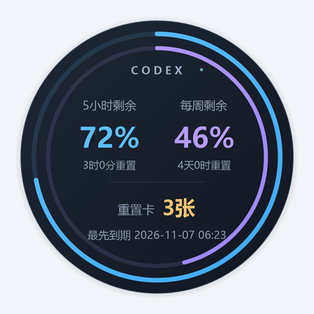
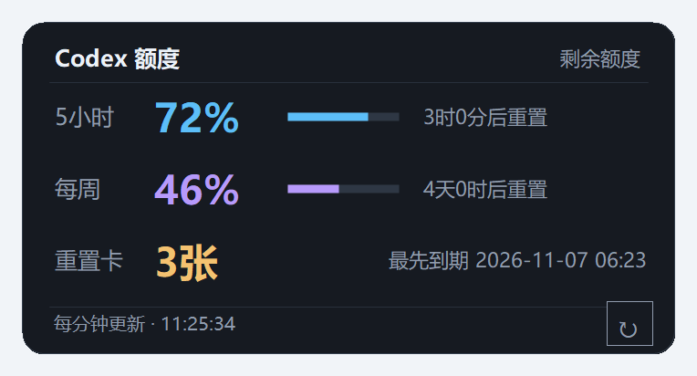

# Codex Usage Float

A small, read-only Codex quota widget for Windows. 界面目前为中文。

在桌面常驻显示 Codex 的 5 小时额度、每周额度和重置卡。三项可分别显示或隐藏，提供圆形仪表和信息卡片两种样式。

## 下载便携版

**[下载 Windows 便携版（ZIP，v1.0.0-preview.2）](https://github.com/Yac836/codex-usage-float/releases/download/v1.0.0-preview.2/CodexUsageFloat-windows-x64.zip)**

[查看 Release 和更新说明](https://github.com/Yac836/codex-usage-float/releases/tag/v1.0.0-preview.2)

下载文件名为 `CodexUsageFloat-windows-x64.zip`。解压后双击 `CodexUsageFloat.exe` 即可启动，无需编译或运行脚本。压缩包内有中文 `使用说明.txt`。

面向 Windows 10/11 x64，需要 .NET Framework 4.8，以及本机已安装并登录的 Codex。没有安装器、开机启动项或额外 NuGet 依赖。

1. 下载 ZIP，解压到一个文件夹，双击 `CodexUsageFloat.exe`。
2. 窗口出现后即可查看额度。首次使用前，先在本机 Codex 中完成登录。
3. 拖动窗口改变位置；右键选择样式、显示项目、大小、透明度、置顶和贴边收起。

每 60 秒查询一次；双击立即刷新。

## 效果预览

以下图片由程序实际绘制代码生成，使用模拟额度和日期；没有真实账户或桌面信息。两种样式均可独立显示或隐藏三项数据。

| 圆形仪表 | 信息卡片 |
| --- | --- |
|  |  |

## 找回窗口 / 远程桌面

- **按 `Ctrl+Alt+U`**：展开并居中到鼠标所在屏幕，恢复最小化状态。
- **双击托盘图标**：任务栏右下角的蓝紫双环图标，可能在“隐藏的图标”中；右键也有“呼出到当前屏幕”。
- **再次运行 EXE**：找回已运行的窗口，仍只保留一个实例。

切换单屏远程桌面、移除显示器或缩小工作区后，程序自动检查位置，把窗口移回屏幕内；收起的小条会展开。自动修复不抢占其他应用的键盘焦点。

快捷键被其他程序占用或注册失败时，托盘提示“快捷键未注册”，菜单会显示“快捷键不可用”和重试入口；托盘双击仍可用。远程桌面需要获得键盘焦点，按键未传到远端时使用远端托盘。

蓝色表示 5 小时额度，紫色表示每周额度，金色显示重置卡。默认显示已用比例，可改为剩余。多张卡显示总张数和最先到期日期，悬停查看已返回的明细。未提供的数据显示“—”或缺失提示，不会猜测为零。

## 读取原理与隐私

程序短暂启动本机的 `codex.exe app-server --listen stdio://`，完成初始化后，仅调用 `account/rateLimits/read`，然后退出辅助进程。查询复用 Codex 自身已保存的登录状态。

- 不直接读取认证文件，不要求 API Key，不发起模型对话，不使用或消耗重置卡。
- 不直接向第三方服务器发送数据；Codex 辅助进程通过自身的联网机制取得额度。
- 仅在 `%LOCALAPPDATA%\CodexUsageFloat\preferences.json` 保存窗口位置和显示选项，正常运行不保存额度历史或日志。
- 辅助进程由独立 Windows Job Object 管理，读取结束或窗口进程退出时清理所属进程。

查找顺序为环境变量 `CODEX_USAGE_FLOAT_CODEX` 指定的现有 EXE、本机 Codex 安装目录、PATH 中的绝对目录。显式配置的路径无效时会报错，不会悄悄改用其他版本。只为可信的 Codex 可执行文件设置该变量。

## 构建和回归

在项目根目录运行 PowerShell：

```powershell
# 输出 build\CodexUsageFloat.exe，不覆盖正在运行的程序
.\source\build.ps1

# 离线回归：模拟接口、独立配置，不需要安装或登录 Codex
.\tests\run.ps1

# 有可交互桌面时，追加实际窗口的原生置顶、焦点与恢复检查
.\tests\run.ps1 -Desktop

# 生成便携包和经过白名单筛选的源码包
.\tools\package.ps1
```

构建使用 Windows 自带的 64 位 .NET Framework C# 编译器。测试和打包失败会返回错误；测试报告默认保存在系统临时目录。完整流程见 [回归说明](docs/TESTING.md)、[检查清单](REGRESSION_CHECKLIST.md) 和 [实现说明](docs/ARCHITECTURE.md)。

GitHub Actions 在 push、Pull Request 和手动触发时，在 Windows runner 上构建、运行离线回归、打包并解压源码包再次构建和回归，最后上传结果及便携包。不需要登录凭据。工作流不会自动发布 Release。

## 限制

- 非 OpenAI 官方产品；app-server 协议可能变化。缺失额度、重置卡或到期明细时，只展示服务实际提供的信息。
- 目前使用系统 DPI 感知；不同 DPI 显示器之间的实时重新缩放尚未实现。位置找回已有自动回归；真实远程桌面切换和不同 DPI 显示器仍需实机检查。
- 置顶针对普通桌面窗口，不保证覆盖独占全屏、系统安全桌面等特殊界面。真实鼠标、多显示器和外观仍需实机回归。
- 圆形按变化重绘；查询会短暂启动 Codex 辅助进程。资源占用取决于 Codex 版本、系统缩放和配置，不提供固定内存保证。
- 便携 EXE 未进行商业代码签名；请从自己信任的源码或维护者产物取得程序。

接口说明：[Codex app-server](https://learn.chatgpt.com/docs/app-server)。贡献与问题反馈见 [CONTRIBUTING.md](CONTRIBUTING.md)，安全问题见 [SECURITY.md](SECURITY.md)。项目使用 [MIT 许可证](LICENSE)。
